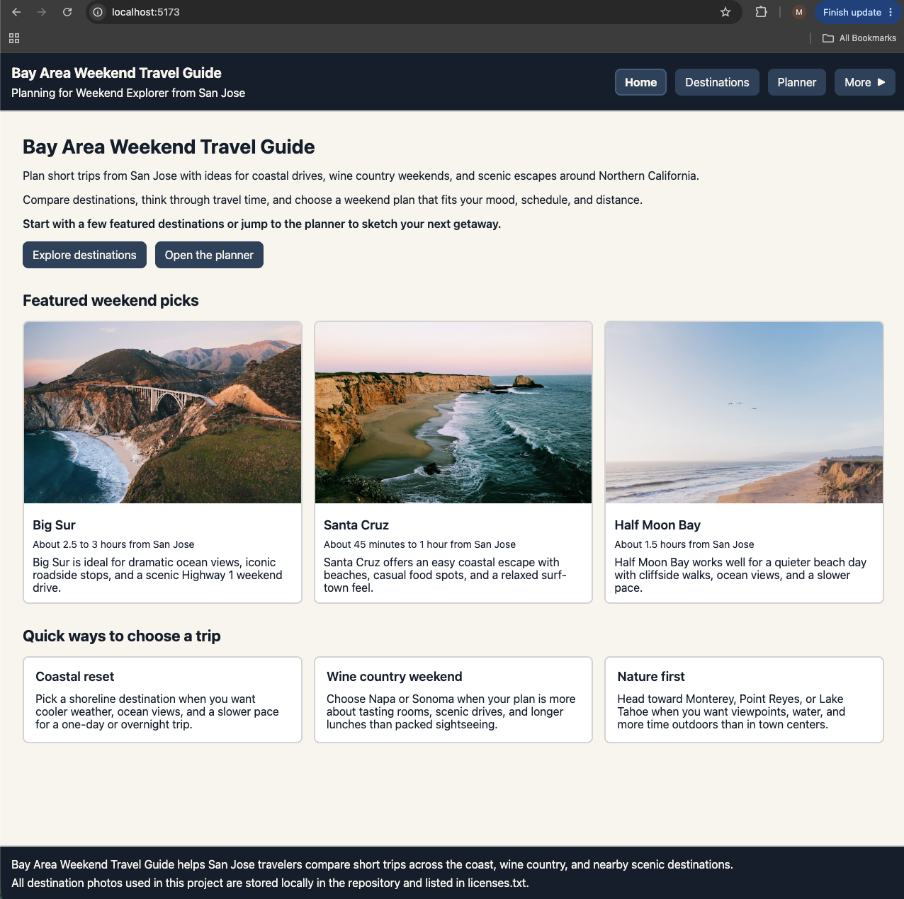

# Bay Area Weekends

A React single-page app for finding and planning weekend getaways from the San Francisco Bay Area. Browse eight destinations across the coast, wine country and nature, filter them by category, and build a simple weekend plan.


 

## Features

- **Single-page navigation** between Home, Destinations, Planner, FAQ and Settings, with no page reloads
- **Destination browser** with eight destinations (Big Sur, Santa Cruz, Monterey, Napa Valley, Half Moon Bay, Point Reyes, Sonoma, Lake Tahoe), each with a photo, drive time and description
- **Category filter** for All, Coast, Wine and Nature
- **Weekend planner form** with dependent dropdowns (the destination list changes with the selected region), an "Other" option with a free-text area, and validation with clear error messages
- **Saved trip summary** shown after a valid submission
- **FAQ** built from accordion sections
- **Light and dark theme** toggle in Settings
- **Traveler profile editor** in a native `<dialog>` modal, with validation, whose values are shown across the app
- **Accessibility**: skip link, semantic landmarks, labelled form fields, alt text on every image, and keyboard-friendly navigation

## Tech Stack

- React 19
- Vite
- Plain CSS, with one stylesheet per component
- ESLint

## Getting Started

Requires [Node.js](https://nodejs.org/) and npm.

```bash
npm install
npm run dev
```

Open the local URL that Vite prints, usually http://localhost:5173. Press `Ctrl+C` in the terminal to stop the server.

### Production build

```bash
npm run build
npx serve -s dist
```

### Other scripts

| Command | What it does |
| --- | --- |
| `npm run lint` | Runs ESLint |
| `npm run preview` | Serves the production build with Vite |

## Project Structure

```
src/
  components/   Reusable UI: GlobalNav, Header, Footer, FilterBar, DestinationCard,
                AccordionSection, SkipLink, TravelerProfileDialog, MainArea
  pages/        HomePage, DestinationsPage, PlannerPage, FaqPage, SettingsPage
  data/         destinations.js, faqEntries.js, plannerOptions.js
  assets/       Destination photos
```

App-wide state (current page, theme and traveler profile) lives in `App.jsx` and is passed down as props.

## Credits

Destination photos are from [Unsplash](https://unsplash.com/license). Sources are listed in [licenses.txt](licenses.txt).

